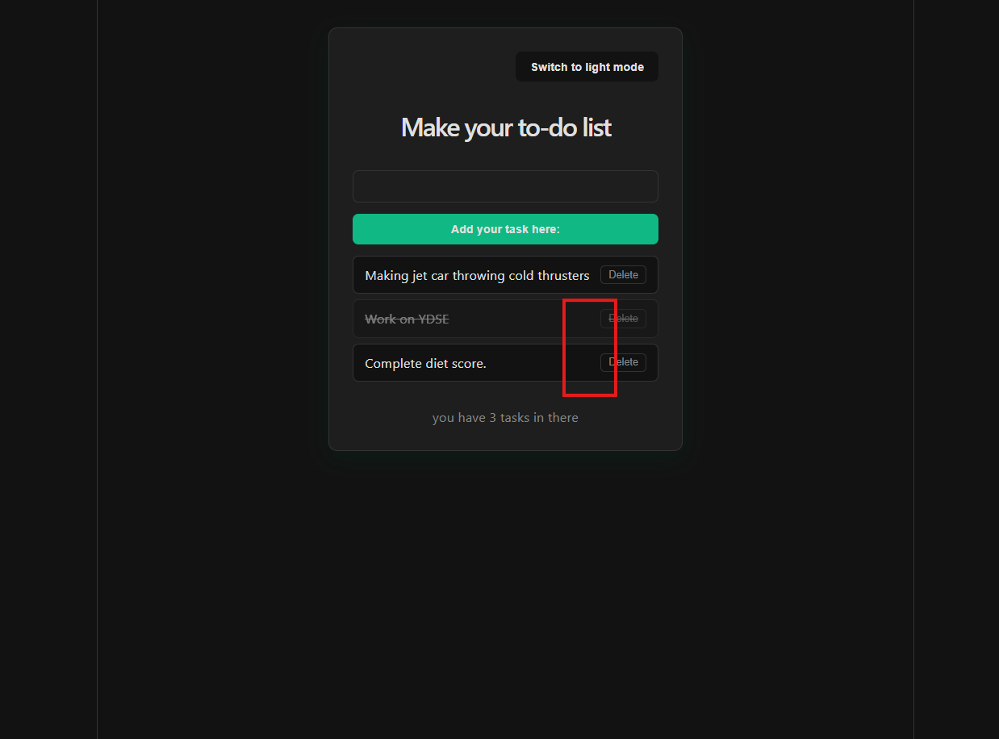

<!-- @format -->

# React To-Do App

A clean, responsive to-do app built with React, featuring dark/light mode and full task management.

## Features

- Add new tasks
- Delete tasks
- Mark tasks as done / not done
- Dark / light theme toggle
- Live task count

## Tech Used

- React (Vite)
- CSS (variables & flexbox)

## How to Run Locally

```
git clone https://github.com/prathuMPO/react-todo-app.git
cd react-todo-app
npm install
npm run dev
```


